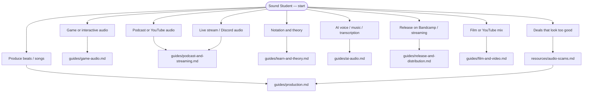

# Sound Student

**One-stop hub for student audio** — music production, game SFX, podcasts, streaming, theory, legal samples, edu pricing, and links to AI voice/music tools. Official vendor sites only; no cracks or warez.

> **Disclaimer:** Student pricing and license terms change on vendor sites only.

> **Scams:** Fake DAW “full versions” and stolen sample packs → [resources/audio-scams.md](resources/audio-scams.md)

You can [navigate](NAVIGATION.md), use **[Start here](resources/start-here.md)**, find [Hub](https://jay-lokhande.github.io/student-dev-catalogs/) (all dev catalogs), and browse [Sister repos](resources/sister-repos.md).

**Pages:** [student-dev-catalogs](https://jay-lokhande.github.io/student-dev-catalogs/) · [oss-programs-and-hackathons](https://jay-lokhande.github.io/oss-programs-and-hackathons/) · [build-grants](https://jay-lokhande.github.io/build-grants/) · [hack-safe](https://jay-lokhande.github.io/hack-safe/) · [ai-catalog](https://jay-lokhande.github.io/ai-catalog/) · [coding-platforms](https://jay-lokhande.github.io/coding-platforms/) · [public-apis](https://jay-lokhande.github.io/public-apis/) · [design-for-devs](https://jay-lokhande.github.io/design-for-devs/) · [cloud-student](https://jay-lokhande.github.io/cloud-student/) · [maker-student](https://jay-lokhande.github.io/maker-student/) · [game-dev-student](https://jay-lokhande.github.io/game-dev-student/) · [sound-student](https://jay-lokhande.github.io/sound-student/)

---

## What do you need?

**Plain text:** unsure → [Start here](resources/start-here.md) · suspicious download → [audio-scams](resources/audio-scams.md) · sample license questions → [samples & licensing](guides/samples-and-licensing.md)

---

## Topic guides (full tables live here)

| Path | Guide |
| --- | --- |
| DAWs, plugins, MIDI, FFmpeg | [guides/production.md](guides/production.md) |
| Student / edu store pricing | [guides/edu-pricing.md](guides/edu-pricing.md) |
| FMOD, Wwise, engine docs | [guides/game-audio.md](guides/game-audio.md) |
| OBS, podcast hosts, Riverside | [guides/podcast-and-streaming.md](guides/podcast-and-streaming.md) |
| CC samples, SFX, attribution | [guides/samples-and-licensing.md](guides/samples-and-licensing.md) |
| Theory, MOOCs, vendor learn portals | [guides/learn-and-theory.md](guides/learn-and-theory.md) |
| Film, YouTube, dialog & LUFS | [guides/film-and-video.md](guides/film-and-video.md) |
| Captions & accessible media | [guides/accessibility.md](guides/accessibility.md) |
| AI TTS / music (bridge to ai-catalog) | [guides/ai-audio.md](guides/ai-audio.md) |
| Before you ship (checklist) | [resources/license-checklist.md](resources/license-checklist.md) |
| Interfaces, mics (official brands) | [guides/hardware.md](guides/hardware.md) |
| Bandcamp, distributors | [guides/release-and-distribution.md](guides/release-and-distribution.md) |
| Programs, jams, scholarships | [guides/programs-and-community.md](guides/programs-and-community.md) |

---

## Quick picks (zero install)

| Goal | Start with |
| --- | --- |
| First recording / edit | [BandLab](https://www.bandlab.com/) or [Audacity](https://www.audacityteam.org/) |
| Free beats (FOSS) | [LMMS](https://lmms.io/) |
| Game jam SFX | [Freesound](https://freesound.org/) + [Sonniss GDC packs](https://sonniss.com/gameaudiogdc) (read license) |
| Stream game + mic mix | [OBS](https://obsproject.com/) + [Voicemeeter](https://vb-audio.com/Voicemeeter/) (Windows) or [BlackHole](https://existential.audio/blackhole/) (macOS) |
| Notation | [MuseScore](https://musescore.org/) |

---

## Machine-readable index

| File | Use |
| --- | --- |
| [data/sound-resources.json](data/sound-resources.json) | All tools by `category` |
| [data/tracks.json](data/tracks.json) | Recommended path steps per goal |

---

## Outside this repo (on purpose)

| Need | Where |
| --- | --- |
| Full AI product list | [ai-catalog](https://github.com/Jay-Lokhande/ai-catalog) |
| Game engines & itch jams | [game-dev-student](https://github.com/Jay-Lokhande/game-dev-student) |
| MOOCs & interview prep | [coding-platforms](https://github.com/Jay-Lokhande/coding-platforms) |
| Captions & accessible media | [design-for-devs](https://github.com/Jay-Lokhande/design-for-devs) |
| Paid OSS summers / hackathons | [oss-programs-and-hackathons](https://github.com/Jay-Lokhande/oss-programs-and-hackathons) |

[CONTRIBUTING.md](CONTRIBUTING.md) · [LICENSE](LICENSE)
